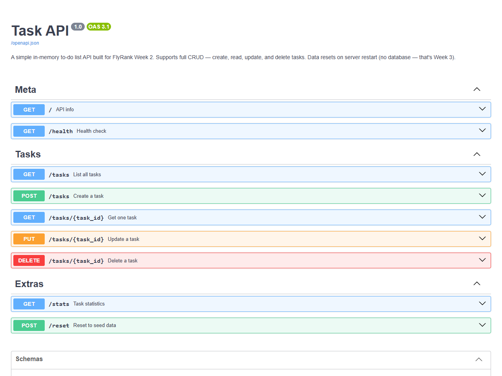

# Task API — FlyRank W2 · A1

A small, fully-functional **CRUD API** for managing a to-do list, built with **Python + FastAPI**. This is the Week 2 Assignment 1 submission for FlyRank's internship programme.

Data lives in memory — no database. Everything resets on server restart, and that's intentional.

---

## Quick start

### 1. Clone and install

```bash
git clone https://github.com/lawdefier/task-api.git
cd task-api
pip install -r requirements.txt
```

### 2. Run the server

```bash
uvicorn main:app --reload --port 8000
```

### 3. Open Swagger UI

Visit **[http://localhost:8000/docs](http://localhost:8000/docs)** — every endpoint is listed with a **Try it out** button that fires real requests.



---

## Endpoints

| Method   | Path           | Status on success | What it does                           |
|----------|----------------|-------------------|----------------------------------------|
| `GET`    | `/`            | 200               | API name, version, endpoint list       |
| `GET`    | `/health`      | 200               | Liveness probe — `{"status":"ok"}`     |
| `GET`    | `/tasks`       | 200               | List all tasks (filter by `done`, `search`) |
| `GET`    | `/tasks/{id}`  | 200 / 404         | Fetch one task by ID                   |
| `POST`   | `/tasks`       | 201 / 422         | Create a task (`{"title":"…"}`)        |
| `PUT`    | `/tasks/{id}`  | 200 / 404 / 422   | Update title and/or done flag          |
| `DELETE` | `/tasks/{id}`  | 204 / 404         | Remove a task (empty body on success)  |
| `GET`    | `/stats`       | 200               | Count total / done / open tasks        |
| `POST`   | `/reset`       | 200               | Restore the 3 seed tasks               |

---

## CRUD → HTTP mapping

| CRUD operation | HTTP method | Example               |
|----------------|-------------|-----------------------|
| Create         | `POST`      | `POST /tasks`         |
| Read           | `GET`       | `GET /tasks`, `GET /tasks/1` |
| Update         | `PUT`       | `PUT /tasks/1`        |
| Delete         | `DELETE`    | `DELETE /tasks/1`     |

---

## Example curl requests

```bash
# List all tasks
curl http://localhost:8000/tasks

# Get task 1
curl http://localhost:8000/tasks/1

# Create a task  →  201 Created
curl -X POST http://localhost:8000/tasks \
     -H "Content-Type: application/json" \
     -d '{"title": "Buy milk"}'

# Missing title  →  422 Unprocessable Entity
curl -X POST http://localhost:8000/tasks \
     -H "Content-Type: application/json" \
     -d '{}'

# Update task 1
curl -X PUT http://localhost:8000/tasks/1 \
     -H "Content-Type: application/json" \
     -d '{"title": "Read FastAPI docs (done)", "done": true}'

# Delete task 2  →  204 No Content (empty body)
curl -X DELETE http://localhost:8000/tasks/2

# Non-existent task  →  404 Not Found
curl http://localhost:8000/tasks/99

# Task stats
curl http://localhost:8000/stats
```

---

## Project structure

```
task-api/
├── main.py              # All routes + Pydantic models
├── requirements.txt     # fastapi, uvicorn[standard]
├── test_checkpoints.py  # Automated checkpoint runner
├── .gitignore
└── README.md
```

## Stages completed

| Stage | Description                                  |
|-------|----------------------------------------------|
| 0     | Hello server — Uvicorn running on port 8000  |
| 1     | Root (`/`) and health (`/health`) endpoints  |
| 2     | Read — list all tasks and get one by ID      |
| 3     | Create — POST with validation (400 / 201)    |
| 4     | Update & Delete — full CRUD complete         |
| 5     | Swagger UI — built-in at `/docs` (FastAPI)   |
| 6     | README, Git history, and GitHub publish      |
| ★     | Bonus: `/stats`, `/reset`, query filters     |

---

## Tech stack

- **Python 3.10+**
- **FastAPI** — modern, async-ready web framework
- **Pydantic v2** — request body validation
- **Uvicorn** — ASGI server
- **Swagger UI** — auto-generated at `/docs` (zero config)
