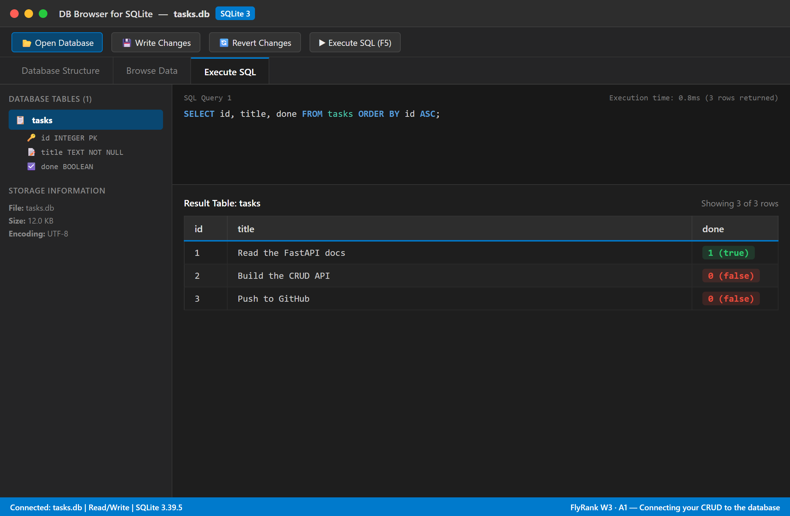

# Task API — FlyRank W3 · A1

A persistent **CRUD API** for managing a to-do list, built with **Python + FastAPI** and backed by a real **SQLite** database (`tasks.db`). 

This project is the Week 3 Assignment 1 submission for the FlyRank internship programme, continuing directly from Week 2 by replacing the in-memory array with relational SQL persistence.

---

## The Big Idea: Storage as an Implementation Detail

In Week 2, tasks were held in memory and disappeared upon server restart. In Week 3, the storage layer was swapped for **SQLite**:

```
Client  -->  FastAPI Router  -->  SQLite Database (tasks.db)
```

The public contract did not change:
- `GET /tasks` still returns the list of tasks.
- `POST /tasks` still creates a task.
- `PUT /tasks/{id}` still updates a task.
- `DELETE /tasks/{id}` still removes a task.

The only difference: **data now permanently survives server restarts.**

---

## Why SQLite?

1. **Zero Configuration**: SQLite requires no external server, daemon, or container setup.
2. **Single-File Storage**: The entire database is stored in a portable file (`tasks.db`) on disk.
3. **Python Standard Library**: Python's built-in `sqlite3` module requires zero third-party dependencies.
4. **Full ACID Compliance**: Provides complete atomicity and durability for reliable transactions.
5. **Seamless Auto-Initialization**: The database file, table schema, and initial seed rows are created automatically on the first run.

---

## Quick Start

### 1. Clone and install

```bash
git clone https://github.com/lawdefier/task-api.git
cd task-api
pip install -r requirements.txt
```

### 2. Run the server

```bash
uvicorn main:app --reload --port 8000
```

> **Note**: On the very first run, `tasks.db` and the `tasks` table will be created automatically, pre-populated with 3 example tasks.

### 3. Interactive Documentation (Swagger UI)

Visit **[http://localhost:8000/docs](http://localhost:8000/docs)** to test all endpoints interactively:


---

## Database Inspection (DB Browser for SQLite)

You can open `tasks.db` in [DB Browser for SQLite](https://sqlitebrowser.org/) or any visual SQLite viewer:



### Database Schema

```sql
CREATE TABLE IF NOT EXISTS tasks (
    id INTEGER PRIMARY KEY AUTOINCREMENT,
    title TEXT NOT NULL,
    done BOOLEAN NOT NULL DEFAULT 0
);
```

---

## Example SQL Queries Executed

During Stage 4 exploration, these SQL statements were executed against `tasks.db`:

### 1. List every task
```sql
SELECT * FROM tasks;
```

### 2. Show only completed tasks
```sql
SELECT * FROM tasks WHERE done = 1;
```

### 3. Count total tasks
```sql
SELECT COUNT(*) FROM tasks;
```

### 4. Mark all tasks as completed
```sql
UPDATE tasks SET done = 1;
```

### 5. Delete all completed tasks
```sql
DELETE FROM tasks WHERE done = 1;
```

You can execute all of these automated exploration queries anytime by running:
```bash
python explore_sqlite.py
```

---

## Endpoints Reference

| Method   | Path           | Status | Description |
|----------|----------------|--------|-------------|
| `GET`    | `/`            | `200`  | API name, version, and storage info |
| `GET`    | `/health`      | `200`  | Liveness probe and DB connectivity check |
| `GET`    | `/tasks`       | `200`  | List all tasks (supports `?done=`, `?search=`, `?sort=`) |
| `GET`    | `/tasks/{id}`  | `200` / `404` | Get single task by ID |
| `POST`   | `/tasks`       | `201` / `422` | Create a new task (`{"title": "..."}`) |
| `PUT`    | `/tasks/{id}`  | `200` / `404` / `422` | Update task title and/or done status |
| `DELETE` | `/tasks/{id}`  | `204` / `404` | Delete task from database |
| `GET`    | `/stats`       | `200`  | SQL `COUNT()` aggregation (total, done, open) |
| `POST`   | `/reset`       | `200`  | Reset database to initial seed tasks |

---

## CRUD to SQL Mapping

| CRUD Operation | HTTP Method | Endpoint          | Underlying SQL Query |
|----------------|-------------|-------------------|----------------------|
| **Create**     | `POST`      | `/tasks`          | `INSERT INTO tasks (title, done) VALUES (?, ?)` |
| **Read (all)** | `GET`       | `/tasks`          | `SELECT id, title, done FROM tasks` |
| **Read (one)** | `GET`       | `/tasks/{id}`     | `SELECT id, title, done FROM tasks WHERE id = ?` |
| **Update**     | `PUT`       | `/tasks/{id}`     | `UPDATE tasks SET title = ?, done = ? WHERE id = ?` |
| **Delete**     | `DELETE`    | `/tasks/{id}`     | `DELETE FROM tasks WHERE id = ?` |

---

## Optional Extras Implemented

- **Keyword Search**: `GET /tasks?search=milk` queries with SQL `LIKE '%milk%'`.
- **Status Filter**: `GET /tasks?done=true` filters with SQL `WHERE done = 1`.
- **Alphabetical Sorting**: `GET /tasks?sort=title` orders with SQL `ORDER BY title ASC`.
- **SQL Aggregations**: `GET /stats` computes metrics via `SELECT COUNT(*) FROM tasks`.
- **Database Reset**: `POST /reset` truncates and restores the initial seed tasks.

---

## Automated Verification Suite

Run the full checkpoint test suite to verify endpoints and database persistence:

```bash
python test_checkpoints.py
```

Sample output:
```text
=================================================================
RUNNING API CHECKPOINT TESTS
=================================================================
Method   Path                         Expect   Got      Pass?
-----------------------------------------------------------------
GET      /                            200      200      PASS
GET      /health                      200      200      PASS
GET      /tasks                       200      200      PASS
GET      /tasks/1                     200      200      PASS
GET      /tasks/99                    404      404      PASS
POST     /tasks                       201      201      PASS
POST     /tasks                       422      422      PASS
PUT      /tasks/1                     200      200      PASS
DELETE   /tasks/2                     204      204      PASS
GET      /stats                       200      200      PASS
GET      /tasks?search=Persistent     200      200      PASS
GET      /tasks?done=true             200      200      PASS

=================================================================
VERIFYING SQLITE DATABASE PERSISTENCE
=================================================================
[PASS] Confirmed row in tasks.db: ID=4, Title='Persistent Task from Test'

All checks passed successfully!
```

---

## Git Commit History (W2 & W3)

```text
* Stage 5: database documentation
* Stage 4: explored SQLite
* Stage 3: update and delete with SQL
* Stage 2: insert into database
* Stage 1: database read endpoints
* Stage 0: create SQLite database
* Stage 6: add README, verification suite, and swagger screenshot (W2)
* Stage 5: swagger documentation and endpoint metadata (W2)
* Stage 4: full CRUD (W2)
* Stage 3: create with validation (W2)
* Stage 2: read endpoints with 404 (W2)
* Stage 1: root and health endpoints (W2)
* Stage 0: hello server (W2)
```
